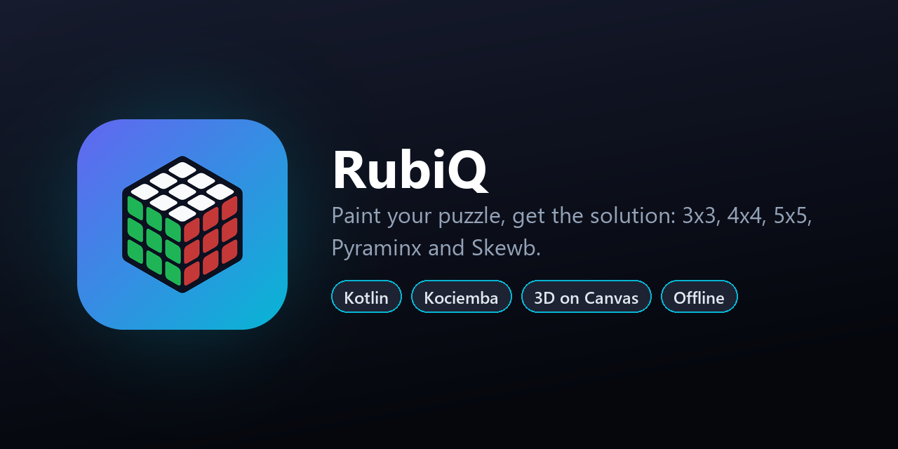

<p align="center">
  
</p>

<p align="center">
  <a href="https://github.com/souvik-das-tech/RubiQ/releases/latest"></a>
  
  
  
  
  
</p>

# RubiQ

**Paint your scrambled puzzle, then follow the solution move by move in 3D.** RubiQ solves the
**3x3**, **4x4**, **5x5**, **Pyraminx** and **Skewb** entirely on the phone. The app requests
**no permissions**: no internet, no storage, no camera.

## Download

Get the latest APK from **[Releases](https://github.com/souvik-das-tech/RubiQ/releases/latest)**
(Android 8.0 or newer).

## Features

- **Five puzzles**: 3x3 Rubik's Cube, 4x4 Revenge, 5x5 Professor's Cube, Pyraminx and Skewb.
- **Interactive 3D view** drawn on a Compose Canvas: drag to rotate, pinch to zoom, tap a
  sticker to paint it. A **flat net** view makes the back and bottom faces easy to paint.
- **Live validation while you paint**: sticker counts, corner twist, edge flip, wing
  orientation and permutation parity, with the offending pieces highlighted.
- **Auto-fix**: repairs single "hand-made" defects (a twisted corner, a flipped edge or wing,
  swapped pieces) from a cube that was taken apart and reassembled wrongly.
- **Step-by-step playback**: play, pause, step forward and back, jump to the start or end, with
  an explanation of every move. Half turns are shown as two 90° steps, so you never have to
  count.
- **Solution stages** for big cubes (centres → edges → parity → 3x3), plus a built-in
  notation guide.
- **Scramble**, reset, copy the solution, and a confetti burst when the puzzle is solved.

## Algorithms

| Puzzle | Method |
| --- | --- |
| **3x3** | Kociemba **two-phase** search, ported from `cubejs`. Unlike a plain two-phase solver it keeps searching for shorter solutions until a time limit, minimising face turns and then 90° steps. Move and pruning tables ship as a bundled asset (`kociemba_tables.bin`). |
| **4x4** | **Reduction**: beam search builds the centres (using pure centre 3-cycles), pairs the 24 wings into 12 edges (slice–flip–slice plus wing 3-cycles), fixes PLL parity, then hands off to the 3x3 solver. |
| **5x5** | **Reduction**: fixes edge parity up front, builds x-centres and t-centres, then pairs wings with their middle edges, then solves as a 3x3. |
| **Pyraminx / Skewb** | **Optimal** meet-in-the-middle search: a table of every state within 6 moves of solved, plus a search of up to 5 moves from the scramble (these puzzles need at most 11 moves). |

The 4x4 and 5x5 commutators were found by **exhaustive search** on the facelet model. The
Pyraminx and Skewb are described generically as *cut polyhedra* (a convex solid plus cutting
planes), and their stickers, pieces, move permutations and net are derived from that geometry.

All solvers run on one long-lived background thread with a large stack, so the UI never
freezes. The search tables are built while you paint.

## Project structure

```
app/src/main/java/com/bbcl/rubiq/
├── CubeModel.kt, Pieces.kt          Generic NxN facelet model and piece orbits
├── Cubie.kt, Tables.kt              Cubie-level 3x3 model, move and pruning tables
├── Kociemba.kt, Cube3x3.kt          Two-phase search and the 3x3 solver
├── Reduction.kt                     Shared beam-search machinery for big cubes
├── Cube4x4.kt, Cube5x5.kt           Reduction solvers
├── Commutators4x4.kt / 5x5.kt       Pure 3-cycle commutators
├── PolyGeometry.kt, PolyPuzzles.kt  Cut-polyhedron geometry, Pyraminx and Skewb
├── PolySolver.kt, PolyAnalysis.kt   Optimal solvers and piece analysis
├── Validate.kt, ValidatePoly.kt     Physical-legality checks
├── AutoFix.kt                       Repair of single physical defects
├── SolverService.kt                 Background solver thread and table warm-up
├── CubeView.kt, PolyView.kt         3D renderers on Compose Canvas
├── NetView.kt                       Flat 2D net
├── HomeScreen.kt, Panels.kt         Paint & Solve, Solution and Checks tabs
└── GuideScreen.kt                   Notation guide
```

## Tests

```bash
./gradlew testDebugUnitTest
```

The tests check that the computed tables match the bundled asset, solve random scrambles of
every puzzle and verify each solution, test move simplification, and test detection and
auto-fix of twisted corners, flipped wings and swapped Skewb centres.

## Tech stack

- **Kotlin 2.4**, **Jetpack Compose** (Material 3, Canvas), Coroutines
- No 3D engine and no third-party solver libraries: everything is implemented in Kotlin
- JUnit 4 for unit tests
- Min SDK 26 (Android 8.0), target SDK 36

## Build from source

Requirements: Android Studio (or the Android SDK with platform 36) and JDK 17+.

```bash
git clone https://github.com/souvik-das-tech/RubiQ.git
cd RubiQ
./gradlew assembleRelease     # app/build/outputs/apk/release/app-release.apk (R8-minified)
```

The release build is signed with the debug key so it installs out of the box. Add your own
`signingConfig` before publishing to a store. The launcher icons and logos are drawn in code by
`python tool/generate_icons.py` (Pillow).

## Acknowledgements

The 3x3 cubie model and the two-phase coordinates are ported from
[cubejs](https://github.com/ldez/cubejs) (MIT), which is based on Herbert Kociemba's
two-phase algorithm.

## License

Released under the [MIT License](LICENSE).

## Author

**Souvik Das** · [GitHub @souvik-das-tech](https://github.com/souvik-das-tech)

If you find this project useful, please consider giving it a ⭐.
